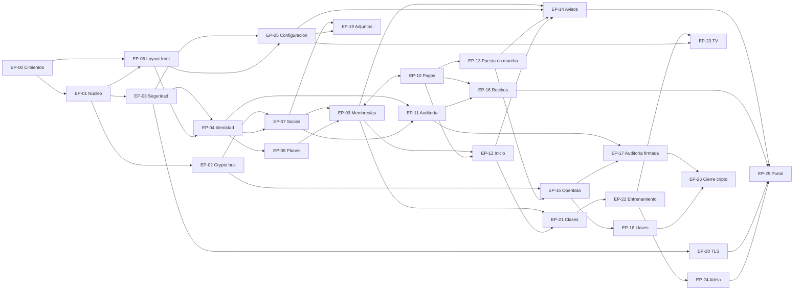

# 06 · Épicas de producto

Fecha: 21 de octubre de 2026.
Entradas: `01_product_discovery.md`, `02_domain_model.md`, `03_context_map.md`, `04_architecture_decision.md`, `05_service_design.md`, `docs/PLAN.md`, `docs/BRECHAS.md`, `CLAUDE.md`, `docs/design/ROUTES.md`, `docs/design/SCREENS-INDEX.md`.

## Resumen

Son 27 épicas (EP-00 a EP-26) que cubren las siete versiones del plan, de v0.1 a v1.0. Catorce están en v0.1, porque ahí vive el núcleo comercial (socios, planes, membresías, pagos) y todo lo que lo sostiene: cimientos, núcleo compartido, criptografía, seguridad, identidad, configuración, auditoría, tablero, front compartido y puesta en marcha. Las otras trece siguen el orden del mapa de contextos (sección 4 de `03_context_map.md`). La ruta crítica pasa por EP-00 → EP-01 → EP-02 → EP-07 → EP-09/EP-10, y la pareja Membresías–Pagos es el cuello de botella de todo lo que viene después.

## Cómo se derivaron

- Hay una épica por bounded context de negocio o de soporte que tiene trabajo propio en una versión. Cuando un contexto tiene trabajo en varias versiones con valor distinto, se parte por versión: Crypto queda en EP-02 (v0.1), EP-15 (v0.2), EP-18 (v0.3) y EP-26 (v1.0), y Audit en EP-11 (v0.1) y EP-17 (v0.3).
- La regla pide que `core` sea una épica propia de v0.1 y, a la vez, que seguridad y criptografía sean épicas explícitas. Para cumplir ambas, `core` se reparte en tres épicas de v0.1: EP-01 (db, config, clock, eventos, hook de auditoría, errores, logging), EP-02 (`core/crypto`, el bus) y EP-03 (`core/security`, rate limit, cabeceras y pruebas de rol). Si se prefiere una sola épica de núcleo, se fusionan las tres sin cambiar su contenido.
- El trabajo de front va dentro de cada épica de negocio (supuestos S1 y S4). EP-06 aporta el layout y el kit de componentes compartidos; EP-00 deja el esqueleto de `web/` con `tokens.css` y los tres componentes base.
- El tablero de inicio (EP-12) fija su contrato en v0.1 con campos `null`; EP-14, EP-21 y EP-22 llenan cada uno su campo. No hay una épica de tablero por versión.
- Training es un solo contexto con dos módulos (`wods` y `results`), así que tiene una sola épica (EP-22, XL). El corte interno sugerido está en la épica.
- Ninguna épica introduce reglas de negocio nuevas. Todo hueco quedó en "Preguntas abiertas".

## Índice de épicas

### v0.1 — Base: socios, planes, membresías, pagos, cifrado
- [EP-00 · Cimientos del repositorio](EP-00-cimientos.md) — L
- [EP-01 · Núcleo compartido de la plataforma](EP-01-nucleo-compartido.md) — M
- [EP-02 · Bus de criptografía y cifrado de datos personales](EP-02-bus-de-criptografia.md) — L
- [EP-03 · Seguridad de la plataforma](EP-03-seguridad-de-la-plataforma.md) — M
- [EP-04 · Identidad y acceso](EP-04-identidad-y-acceso.md) — M
- [EP-05 · Configuración del gimnasio](EP-05-configuracion-del-gimnasio.md) — S
- [EP-06 · Layout y componentes compartidos del front](EP-06-layout-y-componentes-front.md) — L
- [EP-07 · Padrón de socios](EP-07-padron-de-socios.md) — L
- [EP-08 · Catálogo de planes](EP-08-catalogo-de-planes.md) — S
- [EP-09 · Venta y ciclo de vida de membresías](EP-09-membresias.md) — L
- [EP-10 · Registro inmutable de pagos](EP-10-pagos.md) — M
- [EP-11 · Auditoría y trazabilidad](EP-11-auditoria.md) — M
- [EP-12 · Tablero de inicio](EP-12-tablero-de-inicio.md) — S
- [EP-13 · Puesta en marcha y continuidad operativa](EP-13-puesta-en-marcha-y-continuidad.md) — M

### v0.2 — OpenBao y avisos
- [EP-14 · Avisos de vencimiento](EP-14-avisos-de-vencimiento.md) — XL
- [EP-15 · Custodia de llaves con OpenBao](EP-15-custodia-de-llaves-openbao.md) — L
- [EP-16 · Recibos y exportaciones](EP-16-recibos-y-exportaciones.md) — M

### v0.3 — Auditoría firmada, TLS híbrido y adjuntos
- [EP-17 · Auditoría firmada post-cuántica](EP-17-auditoria-firmada.md) — M
- [EP-18 · Administración de llaves de cifrado](EP-18-administracion-de-llaves.md) — M
- [EP-19 · Adjuntos y autorización de tratamiento de datos](EP-19-adjuntos-y-autorizacion-de-datos.md) — M
- [EP-20 · Acceso cifrado con TLS híbrido](EP-20-acceso-cifrado-tls.md) — S

### v0.4 — Clases y asistencia
- [EP-21 · Clases, horario y check-in](EP-21-clases-y-check-in.md) — L

### v0.5 — WODs, resultados y TV
- [EP-22 · Entrenamiento: movimientos, WODs y resultados](EP-22-entrenamiento-wods-y-resultados.md) — XL
- [EP-23 · Pantalla de TV del box](EP-23-pantalla-de-tv.md) — S

### v0.6 — Atleta
- [EP-24 · Perfil del atleta](EP-24-perfil-del-atleta.md) — L

### v1.0 — Portal del socio y cierre
- [EP-25 · Portal del socio](EP-25-portal-del-socio.md) — XL
- [EP-26 · Cierre criptográfico post-cuántico](EP-26-cierre-criptografico-post-cuantico.md) — L

Escala relativa: S (una o dos semanas de una persona), M (dos o tres), L (tres a cinco), XL (más de cinco; candidata a partirse en historias por slice).

## Trazabilidad

| Épica | Bounded context | Versión | Reglas y aggregates principales | Pantallas del diseño |
|---|---|---|---|---|
| EP-00 Cimientos | ninguno (terreno) | v0.1 | Tarea 0; licencias; `banned-api` | ninguna (base de todas) |
| EP-01 Núcleo compartido | core (db, events, audit hook) | v0.1 | RN-14, RN-16; AuditEntry | ninguna |
| EP-02 Bus de criptografía | Crypto | v0.1 | RN-13; CryptoKey, CryptoOp, CryptoJob | ninguna propia (MaskedValue, búsqueda) |
| EP-03 Seguridad de la plataforma | core/security | v0.1 | RN-15 | ninguna (permisos de todas) |
| EP-04 Identidad y acceso | Auth | v0.1 | RN-14, RN-15; User, RefreshToken, OneTimeToken | Login (acceso), Usuarios |
| EP-05 Configuración | Settings | v0.1 | SettingsSection | Config |
| EP-06 Layout y componentes front | presentación (web/) | v0.1 | RN-01 en formato | base de todas; patrones P_Lista, P_Ficha, P_Formulario |
| EP-07 Padrón de socios | Members | v0.1 | RN-13, RN-14; Member | Socios_Lista, Socios_Movil, Socio_Form, Socio_Ficha |
| EP-08 Catálogo de planes | Plans | v0.1 | RN-01, RN-04, RN-08; Plan | Planes |
| EP-09 Membresías | Memberships | v0.1 | RN-03 a RN-07; Membership | Membresias, Membresia_Vender, Socio_Ficha (Membresías) |
| EP-10 Pagos | Payments | v0.1 | RN-01, RN-02, RN-03; Payment | Pagos, Socio_Ficha (Pagos) |
| EP-11 Auditoría | Audit | v0.1 | RN-16; AuditEntry | Auditoria, Socio_Ficha (Historial) |
| EP-12 Tablero de inicio | Dashboard | v0.1 (crece hasta v0.5) | lectura de RN-06 y pagos | Inicio |
| EP-13 Puesta en marcha | ninguno (operación) | v0.1 | regla de datos 8 | ninguna |
| EP-14 Avisos de vencimiento | Notifications (+ Members, Auth) | v0.2 | RN-17; NotificationRule, NotificationTemplate, Notification | PorAvisarHoy, Notif_Reglas, Notif_Historial, Socio_Ficha (Avisos), Login (recuperar y activar) |
| EP-15 Custodia OpenBao | Crypto | v0.2 | RN-13; CryptoKey | ninguna propia |
| EP-16 Recibos y exportaciones | Payments, Members | v0.2 | RN-02, RN-13 | Pagos (recibo), Socios_Lista (exportar) |
| EP-17 Auditoría firmada | Audit (+ Crypto) | v0.3 | RN-16; AuditSignature | Auditoria (estado de firma) |
| EP-18 Administración de llaves | Crypto | v0.3 | CryptoKey, CryptoJob | Llaves |
| EP-19 Adjuntos y autorización | Attachments (+ Members) | v0.3 | RN-13; Attachment | Socio_Form (foto, autorización), Socio_Ficha (Adjuntos) |
| EP-20 TLS híbrido | ninguno (borde) | v0.3 | — | ninguna propia |
| EP-21 Clases y check-in | Classes (+ Memberships) | v0.4 | RN-05, RN-09, RN-10; ClassSlot, ClassSession, Attendance | Sesiones, Horario, CheckIn, Socio_Ficha (Asistencia), Inicio (asistencia) |
| EP-22 Entrenamiento | Training (wods, results) | v0.5 | RN-11, RN-14; Movement, Wod, WodResult | Movimientos, WOD_Lista, WOD_Form, WOD_Detalle, Resultados_Registro, Socio_Ficha (Resultados) |
| EP-23 Pantalla de TV | TV | v0.5 | — | TV |
| EP-24 Perfil del atleta | Athletes | v0.6 | RN-12, RN-13; BodyMetric, PersonalRecord | Atleta_Perfil, Socio_Ficha (Atleta) |
| EP-25 Portal del socio | Portal (+ Auth, Training) | v1.0 | RN-11, RN-15 | Portal_Inicio, Portal_Pagos, Portal_WODs, Portal_Progreso, Portal_Datos, Portal_Avisos |
| EP-26 Cierre criptográfico | Crypto (+ backup) | v1.0 | CryptoKey, CryptoJob | Llaves (CBOM) |

Cobertura: las 37 pantallas de `SCREENS-INDEX.md` quedan asignadas; `Mapa`, `P_Lista`, `P_Ficha` y `P_Formulario` son referencia y no se implementan (`BRECHAS.md` sección 6). Los 16 bounded contexts de `03_context_map.md` y las 17 reglas RN-01 a RN-17 tienen al menos una épica.

## Grafo de dependencias

Una flecha `A → B` significa que A necesita a B. Las dependencias marcadas "suave" no bloquean el inicio; solo el cierre de un criterio.

```
EP-00 Cimientos
 └─► EP-01 Núcleo compartido
      ├─► EP-02 Bus de criptografía
      └─► EP-03 Seguridad de la plataforma
EP-06 Layout front ─► EP-00, EP-01
EP-04 Identidad ─► EP-01, EP-03, EP-06
EP-05 Configuración ─► EP-01, EP-03, EP-06
EP-07 Socios ─► EP-02, EP-04, EP-06   (suave: EP-09 para los chips de estado)
EP-08 Planes ─► EP-04, EP-06          (suave: EP-09 para cerrar RN-08)
EP-09 Membresías ─► EP-07, EP-08, EP-06  ◄─► EP-10 Pagos (pareja, misma iteración)
EP-10 Pagos ─► EP-09, EP-03, EP-06
EP-11 Auditoría ─► EP-01, EP-04, EP-06, EP-07
EP-12 Inicio ─► EP-09, EP-10, EP-06
EP-13 Puesta en marcha ─► EP-00, EP-02, EP-07, EP-08, EP-09, EP-10
EP-14 Avisos ─► EP-09, EP-07, EP-05, EP-13, EP-04, EP-12
EP-15 OpenBao ─► EP-02, EP-13
EP-16 Recibos y exportaciones ─► EP-10, EP-07, EP-11, EP-02
EP-17 Auditoría firmada ─► EP-11, EP-15, EP-13
EP-18 Administración de llaves ─► EP-02, EP-15, EP-06
EP-19 Adjuntos ─► EP-07, EP-02, EP-05, EP-11
EP-20 TLS híbrido ─► EP-03, EP-00
EP-21 Clases y check-in ─► EP-09, EP-07, EP-05, EP-12, EP-06
EP-22 Entrenamiento ─► EP-21, EP-07, EP-12, EP-06
EP-23 TV ─► EP-22, EP-05, EP-03, EP-06
EP-24 Atleta ─► EP-22, EP-02, EP-07, EP-06
EP-25 Portal ─► EP-04, EP-07, EP-09, EP-10, EP-14, EP-16, EP-20, EP-22, EP-24, EP-06
EP-26 Cierre criptográfico ─► EP-15, EP-17, EP-18, EP-13
```



El diagrama Mermaid omite algunas aristas redundantes (las que ya se cumplen por transitividad); la lista de texto es la completa.

Ruta crítica: EP-00 → EP-01 → EP-02 → EP-07 → EP-09/EP-10 → EP-12 → EP-21 → EP-22 → EP-24 → EP-25.
Trabajo paralelo posible en v0.1: EP-03, EP-05 y EP-06 en paralelo con EP-02; EP-08 en paralelo con EP-07; EP-11 en cuanto existan EP-04 y EP-07.

## Preguntas abiertas

Heredadas de los documentos anteriores, todavía sin cerrar en el gate:

- P1: quién atiende recepción; si hay recepcionistas, el rol admin necesita separarse de "dueño" (v1.1).
- P2: vigencia máxima de los planes por clases (se asume que sí).
- P3: destino externo del backup desde el día uno (se asume S3 compatible por `.env`; si no, local).
- P4: recibo PDF en v0.1 o v0.2 (se asume v0.2, EP-16).
- P5: correo de login en claro en `auth.users.email` mientras `members.email` va cifrado.
- P6: coach que también es socio (se asume v1.1).
- P7: dominio público con TLS desde v0.1 o solo LAN (se asume LAN; si hay dominio, EP-20 se adelanta a v0.1 y EP-25 podría adelantarse).
- La interpretación de "core como una épica" frente a "seguridad y criptografía como épicas explícitas" (ver "Cómo se derivaron"): confirmar si se aceptan tres épicas de núcleo en v0.1.

Huecos nuevos detectados al derivar las épicas:

- Q1 · Renovar antes de vencer (EP-09): la invariante "un socio tiene como máximo una membresía en `pending_payment`, `active`, `expiring` o `frozen`" choca con `next_start_for_renewal`, que crea la nueva membresía al día siguiente del fin de la vigente mientras esta sigue activa. ¿La membresía futura cuenta como vigente? ¿Se permite una vigente más una futura?
- Q2 · Endpoint de renovar (EP-09): `PLAN.md` define `POST /memberships/{id}/renew`, `05_service_design.md` no lo lista en el contrato y `ROUTES.md` reutiliza vender con `?renovar=1`. ¿Cuál queda?
- Q3 · Estado `pending_payment` en el diseño (EP-07, EP-09): no está entre los estados de RN-06 ni entre los chips de la lista de socios ("Al día", "Por vencer", "Vencidos", "Congelados", "Sin membresía", "Dados de baja"). ¿Cómo se muestra un socio con membresía vendida y sin pago completo?
- Q4 · Planes por clases antes de v0.4 (EP-09, EP-21): `classes_remaining` solo baja con el check-in, que llega en v0.4. Entre v0.1 y v0.3, ¿un plan por clases se comporta como uno por días?
- Q5 · Pagos que superan el precio pactado (EP-10): RN-03 activa con "mayor o igual", pero no dice si un excedente se rechaza, se acepta o se abona a la siguiente membresía.
- Q6 · Rol para mostrar datos en claro (EP-07, EP-24): RN-13 exige auditar el `reveal`, pero no dice si el coach puede hacerlo o solo el admin.
- Q7 · Rol para congelar (EP-09): `ROUTES.md` dice que el coach vende y registra pagos y no anula; no dice si congela.
- Q8 · Rol para borrar una asistencia (EP-21): `DELETE /attendance/{id}` devuelve una clase al plan, con efecto en plata; no hay rol declarado.
- Q9 · Límites de congelación (EP-09): no hay máximo de días, ni número máximo de congelaciones por membresía, ni antelación mínima.
- Q10 · "Últimos movimientos" del tablero (EP-12): no está definido si son pagos, ventas, cambios de auditoría o una mezcla.
- Q11 · Contenido de las secciones `memberships` y `classes` de Settings (EP-05): si `memberships` permite configurar el umbral de "por vencer", contradice el 7 fijo de RN-06; hay que decidir qué guarda cada sección.
- Q12 · Credenciales de canales de aviso (EP-05, EP-14): ¿van en Settings (auditadas, y por tanto visibles en la auditoría) o en `.env`, o cifradas por el bus?
- Q13 · Avisos sin regla (EP-14, EP-24): el catálogo de eventos nombra avisos de bienvenida (`MemberCreated`), de confirmación (`MembershipActivated`) y de récord (`PersonalRecordSet`), pero `NotificationRule.trigger` solo admite `membership_expiring` y `membership_expired`. ¿Se agregan esos disparadores, y en qué versión?
- Q14 · Web push sin suscriptores (EP-14, EP-25): el canal web push entra en v0.2, pero el socio solo puede suscribirse desde el portal en v1.0. ¿Se mantiene el canal en v0.2 sin uso real, o se pospone?
- Q15 · Exportación de pagos (EP-16): `BRECHAS.md` propone `GET /payments/export` y `05_service_design.md` solo define la exportación de socios. ¿Entra la de pagos?
- Q16 · Autorización de socios existentes (EP-19): desde v0.3 `data_consent_at` es obligatorio para crear; no hay regla para los socios creados antes (¿se les pide al renovar, se bloquea algo, solo se marca?).
- Q17 · Formato del Excel de origen (EP-13): `import-members` no tiene definidas las columnas ni el manejo de filas sin documento.
- Q18 · Unicidad de resultados con corrección (EP-22): RN-11 dice uno por WOD y socio, y la corrección crea un registro nuevo con `supersedes_id`. ¿La unicidad aplica solo a los no reemplazados?
- Q19 · "Movimiento principal" de un WOD (EP-24): RN-12 deriva el récord sobre el movimiento principal, pero `Wod` y `WodMovement` no marcan cuál es.
- Q20 · Récords de benchmark (EP-24): solo hay regla de derivación por carga; no se sabe si un mejor tiempo en un benchmark crea récord automático o solo manual.
- Q21 · Medidas cifradas (EP-24): `02_domain_model.md` cifra `weight_kg` con `athlete.metric`, mientras RN-13 y la tabla de clases de dato hablan de "peso y medidas". ¿Se cifran también `height_cm` y `body_fat_pct`?
- Q22 · Socios con `sex` nulo en el leaderboard (EP-22): no se dice en qué filtro aparecen.
- Q23 · Cambios de horario con sesiones generadas (EP-21): no hay regla sobre si las sesiones futuras ya generadas se regeneran o se conservan.
- Q24 · Campos editables por el socio en el portal (EP-25): `BRECHAS.md` propone teléfono, correo y contacto de emergencia, nunca el documento; falta confirmarlo.
- Q25 · Pantalla "Hoy" del coach: la sección de permisos de `ROUTES.md` menciona "Hoy" como algo que el coach ve, pero no hay ruta ni pantalla con ese nombre.
- Q26 · Fecha del CBOM (EP-18, EP-26): `BRECHAS.md` propone adelantarlo a v0.3 o dejar el botón deshabilitado; el plan lo tiene en v1.0.
- Q27 · ML-DSA en OpenBao (EP-17): depende de OpenBao 2.7 o superior; si no está disponible a tiempo, ¿se bloquea la épica o se firma temporalmente con Ed25519?
- Q28 · Qué "hoy" usa `compute_status` (EP-09): las fechas de membresía son fechas, no horas; hay que fijar que "hoy" es la fecha de Bogotá y no la de UTC, porque entre las 19:00 y las 24:00 de Bogotá ya es el día siguiente en UTC.
